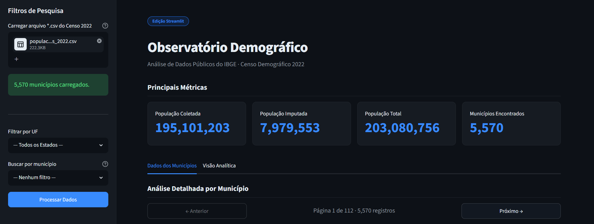

# Observatório Demográfico · IBGE Censo 2022

> Dashboard analítico desenvolvido com **Streamlit**, **Pandas** e **Plotly** para explorar dados populacionais do Censo Demográfico 2022 do IBGE em uma aplicação web Python.

🔗 **[Acesse a aplicação em produção](https://observatorioapp.streamlit.app/)**



---

## Sobre o projeto

O **Observatório Demográfico** é uma aplicação web interativa que permite explorar dados populacionais municipais do **Censo Demográfico 2022 do IBGE** a partir de um arquivo CSV carregado pelo usuário.

Esta versão foi desenvolvida em **Streamlit** como uma adaptação didática de um projeto anterior feito com **HTML, CSS e PyScript/WebAssembly**.

A principal diferença entre as versões está no paradigma de execução:

* Na versão PyScript, o Python executava diretamente no navegador.
* Na versão Streamlit, o Python executa em um servidor.
* O navegador exibe a interface gerada e atualizada pelo Streamlit.
* A interface é construída com componentes prontos, sem manipulação manual de DOM.

Este projeto é usado na disciplina de **Programação Web Front-End (com Python)** para demonstrar um segundo paradigma de desenvolvimento web com Python: aplicações orientadas a dados usando servidor Python e componentes visuais de alto nível.

---

## Funcionalidades

* Upload de arquivo CSV com dados do Censo 2022
* Leitura e processamento dos dados com Pandas
* Filtro por UF
* Busca por município
* Cards de métricas:

  * População coletada
  * População imputada
  * População total
  * Número de municípios encontrados
* Tabela paginada com 50 registros por página
* Ranking dos 5 municípios mais populosos
* Visualização proporcional por macrorregião
* Visualização Capital x Interior quando uma UF é selecionada
* Gráficos interativos com Plotly
* Organização da interface com sidebar, colunas e abas
* Controle de estado com `st.session_state`
* Cache de carregamento com `st.cache_data`

---

## Diferença em relação à versão PyScript

| Aspecto             | Versão PyScript                 | Versão Streamlit         |
| ------------------- | ------------------------------- | ------------------------ |
| Execução do Python  | No navegador via WebAssembly    | No servidor Python       |
| Interface           | HTML e CSS escritos manualmente | Componentes Streamlit    |
| Manipulação da tela | DOM manual                      | Renderização automática  |
| Estado da aplicação | Variáveis globais no navegador  | `st.session_state`       |
| Gráficos            | CSS puro alimentado por Python  | Plotly                   |
| Deploy              | Hospedagem estática             | Servidor Streamlit       |
| Modelo mental       | Front-end tradicional           | Aplicação Python reativa |

---

## Como o Streamlit funciona neste projeto

No Streamlit, a aplicação é escrita como um script Python comum.

Cada comando `st.*` cria um componente visual na interface:

```python
st.title("Observatório Demográfico")
st.metric("População Total", "203 milhões")
st.dataframe(df)
st.plotly_chart(fig)
```

Quando o usuário interage com a aplicação, por exemplo selecionando uma UF ou carregando um CSV, o Streamlit reexecuta o script Python do início ao fim.

Para preservar informações entre essas reexecuções, o projeto utiliza:

```python
st.session_state
```

Esse recurso funciona como uma memória da sessão do usuário.

---

## Stack tecnológica

| Camada        | Tecnologia                                   | Papel                             |
| ------------- | -------------------------------------------- | --------------------------------- |
| Aplicação Web | Streamlit                                    | Framework principal da interface  |
| Linguagem     | Python                                       | Lógica da aplicação               |
| Dados         | Pandas                                       | Leitura, filtragem e agregação    |
| Gráficos      | Plotly                                       | Visualizações interativas         |
| Estado        | `st.session_state`                           | Persistência entre reexecuções    |
| Cache         | `st.cache_data`                              | Otimização do carregamento do CSV |
| Deploy        | Streamlit Community Cloud / servidor próprio | Publicação da aplicação           |

---

## Dependências

O projeto utiliza as seguintes dependências mínimas:

```txt
streamlit>=1.58.0
pandas>=3.0.3
plotly>=6.8.0
```

Essas dependências devem estar registradas no arquivo:

```txt
requirements.txt
```

---

## Como executar localmente

### 1. Clone ou baixe o projeto no terminal

```bash
git clone adicione-aqui-a-url-do-repositorio
cd observatorio-demografico-streamlit
```

Ou baixe o ZIP do projeto e abra a pasta no VS Code.

---

### 2. Atualize o pip

```bash
python -m pip install --upgrade pip
```

---

### 3. Instale as dependências

```bash
pip install --upgrade -r requirements.txt
```

---

### 4. Execute a aplicação

```bash
streamlit run app.py
```

Depois disso, o Streamlit abrirá automaticamente a aplicação no navegador.

Caso não abra automaticamente, acesse manualmente o endereço indicado no terminal, normalmente:

```txt
http://localhost:8501
```

---

## Como usar a aplicação

1. Execute a aplicação com `streamlit run app.py`.
2. No painel lateral, clique em **Carregar arquivo *.csv do Censo 2022**.
3. Selecione o arquivo CSV preparado com os dados municipais.
4. Use os filtros de UF e município.
5. Explore as métricas, a tabela paginada e os gráficos interativos.

---

## Onde obter os dados

Os dados são públicos e estão disponíveis no FTP do IBGE:

```txt
https://ftp.ibge.gov.br/Censos/Censo_Demografico_2022/
  Populacao_e_domicilios_Primeiros_resultados/
  Resultados_da_2a_apuracao_20231027/
```

O arquivo esperado pela aplicação deve conter dados populacionais por município, incluindo colunas equivalentes a:

* UF
* Código do município
* Nome do município
* População coletada
* População imputada
* População total

---

## Preparação do CSV

Os arquivos originais do IBGE podem vir em formatos como `.ods` ou `.xlsx` e podem conter cabeçalhos institucionais, notas explicativas e linhas de rodapé.

Antes de carregar o arquivo na aplicação, recomenda-se preparar a planilha da seguinte forma:

1. Remova as linhas iniciais de título institucional.
2. Garanta que a primeira linha da planilha contenha apenas os nomes das colunas.
3. Remova notas, fontes e observações localizadas abaixo da tabela.
4. Mantenha apenas os registros dos municípios.
5. Exporte o arquivo final como CSV em codificação UTF-8.

---

## Estrutura do repositório

```txt
observatorio-demografico-streamlit/
├── app.py               # Versão Streamlit com Personalização Visual
├── requirements.txt     # Dependências do projeto
├── README.md            # Documentação do projeto
├── images/
|    └── og-preview.png  # Imagem de preview, se utilizada
└── .streamlit/
    └── config.toml      # Arquivo de configuração do tema do streamlit
```

---


## Contexto acadêmico

Este projeto foi desenvolvido para a disciplina **Programação Web Front-End com Python**.

Ele faz parte de uma sequência didática que compara diferentes formas de construir aplicações web com Python:

| Etapa                | Paradigma                                                          |
| -------------------- | ------------------------------------------------------------------ |
| HTML + CSS           | Estrutura e estilo escritos manualmente                            |
| PyScript/WebAssembly | Python executando no navegador                                     |
| Streamlit            | Python executando no servidor com interface gerada automaticamente |

O objetivo não é apenas construir um dashboard, mas compreender as diferenças arquiteturais entre essas abordagens.

---

## Licença e fontes

- **Código-fonte:** [MIT](LICENSE) - livre para uso, estudo e adaptação com atribuição
- **Dados:** domínio público - [Censo Demográfico 2022, IBGE · Diretoria de Pesquisas (DPE) · Coordenação Técnica do Censo (CTD)](https://ftp.ibge.gov.br/Censos/Censo_Demografico_2022/Populacao_e_domicilios_Primeiros_resultados/Resultados_da_2a_apuracao_20231027/)
